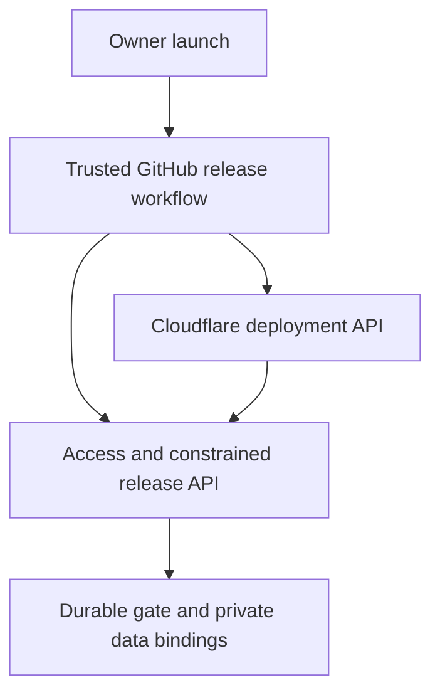

# R2 release automation — Phase 1 design validation

Date: 2026-10-19 Pacific. Work: **CC-TODO-020 / CC-TODO-022**; backup dependency **CC-TODO-019**. **Recommendation proposed; Phase 2 is not authorized by this document.** No new task or decision ID is allocated. Next unused: CC-TODO-025 / CC-DEC-023.

## Recommendation and approval boundary

Use **GitHub Actions as the release/recovery orchestrator, Cloudflare Worker versions as deployment artifacts, and the existing R2 maintenance gate as the durable application safety boundary**. Add small, tested release-client commands and constrained machine endpoints; do not start a separately hosted release controller, another queue, or a second maintenance-state store. A workflow still needs application-specific sequencing and verification: native platforms do not supply a complete catalog release transaction.

This is sufficient for schema-preserving, gate-compatible releases with **bounded automatic recovery and fail-closed escalation**, after a separately approved R1 bootstrap. It cannot guarantee recovery within a fixed time during platform outages or automatically clear an unproven interrupted write. If those stronger guarantees become requirements, reconsider a stable independent control/ingress service; do not disguise it as a minor workflow change.

Prefer the native GitHub **Run workflow** action as the initial release entry: the owner selects an already-reviewed immutable candidate and starts the single authorized operation. No second production approval follows that launch. An in-catalog Release button is a distinct UX decision: it can dispatch the same fixed workflow through a narrowly installed GitHub App, but needs an additional app credential and dispatch endpoint. Do not silently substitute the GitHub UI if the owner requires the button inside the catalog.

**Owner approval needed before Phase 2:** (1) workflow-led architecture and initial launch surface; (2) the machine trust/credential design below and a single production deployment writer; (3) a separately reviewed, one-time R1 bridge maintenance procedure. These are proposals, not credential or production-change grants. Current research and documentation publication require none of those actions.

## Alternatives evaluated

| Alternative | Assessment / reason not recommended now |
| --- | --- |
| Existing release-branch push plus Cloudflare Workers Builds alone | Reuses current hosting, but does not itself provide drain, authenticated outcome verification, interrupted-run reconciliation or one atomic release decision. Keep it as a fallback transport only if a later rehearsal shows direct version promotion unsupported; never run both deployment writers |
| One long Actions job with only final cleanup | Less code, but runner loss/cancellation can skip cleanup. Retain independent bounded recovery entry points and durable application state |
| Unlock when a lease/heartbeat expires | Reject: neither an old writer nor an already-sent deployment API call is proven stopped by elapsed time |
| Separate hosted release controller / Cloudflare Workflow / Durable Object coordinator | Could improve orchestration or independent availability, but adds resources, permissions and another operational component while the same application/data fencing proof is still necessary. Reconsider for stronger availability or unattended orphan-recovery requirements, not by default |
| Ordinary owner browser cookies or machine service token mapped to human owner | Reject: merges trust boundaries and gives unnecessary catalog authority. Keep human auth unchanged and add dedicated machine controls |
| Automatic D1/R2 restore whenever code rollback occurs | Reject: risks erasing newer edits and conflates code compatibility with data recovery. Routine path is compatible code only |

## Restored baseline and evidence classification

| Evidence | Verified in this investigation | Limits |
| --- | --- | --- |
| Main | `4cf0cc22c34928fa79e4e10c1418f9ed7c28c15f`; framework closeout PR #9 | Later source drift must be checked before implementation |
| Active R2 | PR #7 open at `912e0981c9ec4a1c2b7e8ce954561f29fd9433c8`, branch `feature/cc-infrastructure-foundation` | Code inspection is not live acceptance; branch is not pushed in this batch |
| Framework | [pin](../policies/README.md), v1.0.0, source `53aa39ccedce935a702f44072cc647231c8cc02e`; both local policy digests match the manifest | No policy exception or redesign |
| Production | Existing R1 closeout records v0.1.0 and production-only editing; production branch `62e92a16a1e32975ee6bc7f15679183120315411` | No authenticated Cloudflare inventory or fresh live production check in Phase 1 |
| Toolchain | R2 lockfile pins Wrangler 4.149.0 and Cloudflare Vite plugin 1.63.1 | Documented commands must still be rehearsed with these exact versions |
| Existing checks | Four read-only release-preflight/production-config tests passed locally | They do not test deployment, machine auth, recovery orchestration or release readiness |
| External capability | Official primary sources checked on this date; source index below | Account entitlement, effective tokens/policies, deployment triggers and actual JWT claims are not provisioned or proven here |

Restored main and active-R2 README/core records, charter, R2 plan, release/reliability notes and relevant runtime/workflow/test code. No AGENTS.md was found in the inspected source. Preserve the charter's execution continuity and existing IDs. CC-TODO-001's narrow restoration evidence gap is unchanged and does not become a release feature.

## Verified platform capabilities

- **Cloud execution:** standard GitHub-hosted Ubuntu runners execute checkout, Node/npm, tests and Wrangler on GitHub-managed machines [S1], [S2]. Browser launch does not require npm, PowerShell, Wrangler or security changes on Jay's managed PC. Browser/network access to GitHub and owner configuration access are still necessary.
- **Deployment artifacts:** Cloudflare separates version upload from traffic deployment. Worker versions include code/assets/bindings/settings; stored D1/R2 data is separate. Upload first, retain the returned version UUID, then deploy that UUID to 100% traffic; keep trigger changes outside routine releases [S3], [S4]. No gradual mixed-version rollout for this initial maintenance protocol.
- **Rollback:** the native rollback command creates a deployment selecting a prior version. It does not rewind bound data. Secret/binding/data incompatibility can prevent safe rollback; never use forced deployment to override such a block [S5], [S6]. Inspect the explicit prior version, not whichever version happens to be “previous.”
- **Serialization:** Actions concurrency can prevent participating workflows from overlapping. Use one production group shared by release and recovery and `cancel-in-progress: false`; default pending-run replacement and queue ordering are not a freshness guarantee [S7]. Revalidate candidate intent and actual production baseline after acquiring serialization.
- **Interruption:** an `always()` cleanup job helps ordinary failures/cancellation, but cannot guarantee cleanup after runner loss. A separate trusted `workflow_run` recovery workflow, scheduled reconciliation and manual resume provide additional attempts. Scheduled runs can be delayed/dropped or disabled through inactivity; they are not an availability SLA [S8], [S9]. The durable gate must remain paused on uncertainty.
- **Permissions:** current Cloudflare documentation supports **Editor scoped to an individual existing Worker** for version upload/deploy/rollback. Deploying a Worker with existing D1/R2 bindings does not require direct data-store privileges. Routes/domain changes and new resources require additional permissions and are excluded here [S10]. Effective account/token behavior still needs a controlled permission rehearsal.
- **Verification:** a version metadata binding exposes the runtime version UUID; pair it with API deployment readback and the app's exact build SHA/environment checks [S11]. Build success or a healthy-looking root HTML response alone is insufficient.

## Existing implementation: reuse and gaps

All paths below refer to [the inspected R2 commit](https://github.com/JBrickey23/Cookie_Catalog/tree/912e0981c9ec4a1c2b7e8ce954561f29fd9433c8).

| Area | Reuse | Gap / implication |
| --- | --- | --- |
| `.github/workflows/release-preflight.yml`, `tools/release-preflight.mjs` | Full candidate/baseline SHA, clean tracked tree, stable version increase, production config checks, SQL-change refusal, read-only plan artifact | Not dispatchable from main yet; verifies no live recovery/gate/deployment. Current 0.1.0 candidate version correctly fails re-release. Does not prove candidate is approved main ancestry or that data semantics stay compatible |
| `tools/check-production-config.mjs` | Separate production Worker, D1, private R2 and Access audience; previews disabled | Local configuration is not effective remote state. Add immutable config/asset/toolchain hashes and prevent routine route/secret/binding/trigger changes |
| `app/src/server/release-maintenance.ts` | R2 conditional-write gate, admission registration plus generation recheck, durable receipts, pending-job check, no automatic expiry | Gate contains no runner ownership/attempt/phase/previous Cloudflare version. Finish trusts `confirmed` plus outcome assertion. Receipt retries and crash-after-write acknowledgment need idempotent reconciliation |
| `app/src/worker.ts` | Mutable HTTP and scheduled backup/photo work use the same gate; read operations remain separate | Preserve all paths. Any new machine controls must avoid self-registering as ordinary writes and must not grant general catalog authority |
| Gate drain status | Live registrations prevent release; orphan registrations fail closed | No safe automatic reaping/fencing of a still-running operation. Preserve that protection. Backup status checks list only 20 jobs and safely block when truncated; paginate boundedly or return a clear capacity failure, never silently ignore later jobs |
| `access-identity.ts` | JOSE signature/issuer/audience/time verification; server-owned human membership | Service tokens are intentionally rejected (nonempty human subject/email required). Do not map a machine token to owner or relax the ordinary verifier |
| `ReleaseNotice.tsx`, `EntryEditor.tsx`, workspace/recovery APIs | 15-second maintenance polling, dirty drafts retained, 423 rejection and revision/atomic-write checks | No deployed-version epoch handshake or clean-session refresh. Row revisions alone do not invalidate a stale client after a code-only release |
| Build/infrastructure report | Exact build commit/environment, supported schema/migrations/FKs and sampled originals | Machine-safe report and runtime version UUID missing. Existing report is owner-only and exposes more operational detail than CI needs; sampled files do not prove complete recovery |

Avoid duplicating the gate, a job queue, full-catalog backup on every ordinary Save, or a custom hosted deployment scheduler. A small repository-owned release client shared by normal/recovery workflows is appropriate application glue, not a new control-plane service.

## Trust boundaries and minimum authentication

The owner authorizes a fixed candidate; GitHub executes it; Cloudflare's control plane changes traffic; the application verifies its machine caller and protects private data. Runtime credentials never flow to the browser. Public Actions logs/artifacts must contain no catalog exports, originals, private identities, bearer tokens or raw private error bodies.

| Boundary / credential | Proposed minimum | Explicit exclusions and owner step |
| --- | --- | --- |
| GitHub workflow launch | Owner's normal GitHub authorization; trusted workflow definition on protected main; reviewed full candidate SHA passed as data | No copied human session/JWT. Keep human release authority separate from app owner membership |
| `GITHUB_TOKEN` | `contents: read`, `actions: read` for exact checks/run-state/artifact lookup; `deployments: write` only if publishing GitHub deployment statuses; `id-token: write` only in machine-control jobs | No administration/security/issue permissions or main bypass. A later release-ref ledger job may need `contents: write`; it must not be a deploy trigger or rewrite main |
| Cloudflare API token | **Individual Worker Editor**, only existing `cookie-catalog-prod`; account ID as configuration | No new Worker/admin, Access edit, routes, direct D1/R2 data or token-management permissions. Editor can change that Worker's code/secrets/settings; code may access its bindings, so this is powerful, not a data-isolation guarantee. Owner creates and tests scope later; never silently widen it |
| Access machine path | Separate path-specific Access application for proposed `/api/release-automation/*`, Service Auth permitting exactly one expiring release service token | Client ID/secret in GitHub production environment secrets. Existing human Access application and human membership remain unchanged. Exact path coverage and `workers.dev` behavior require future account verification [S12], [S13] |
| App machine principal | Separate verifier: signed Access app JWT, exact machine audience/team/time, `common_name` equal to approved service client ID; service subject shape handled correctly | A service JWT has `type: app`, empty `sub`, no human email; it is not identified by an invented `type: service` value [S14]. Deny ordinary catalog/original/export/restore/import routes to this principal |
| Runner identity and replay limits | Also verify short-lived GitHub OIDC proof with dedicated app audience, signature/issuer/time, immutable repo/owner IDs, exact workflow/ref/environment/event policy and signed run ID/attempt; bind controls to persisted release ID/epoch/target | No new standing OIDC secret. Do not assume the legacy subject format; inspect actual claims, then configure an exact allowlist. Workflow SHA identifies orchestration source, not an arbitrary candidate input. OIDC does not replace the Cloudflare API token [S15] |

The dual machine proof is justified: Access controls who reaches the path; OIDC binds who may own a run/attempt and prevents an old runner from claiming a successor's identity. Keep a narrow verb/action allowlist: claim/status, heartbeat/phase evidence, readiness and a bounded internal recovery-checkpoint action, finalize/recover; read-only verification exposes only source/version/environment and bounded health booleans. No generic HTTP proxy, SQL runner, R2 key editor or unlocked “owner” machine account.

Gate ownership uses compare-and-swap with release ID, target, expected epoch and signed run/attempt. Takeover requires evidence the prior run/attempt is terminal and no unresolved deployment command remains, then a conditional owner-generation change. A timeout/expired heartbeat alone is insufficient. The GitHub reader in the trusted recovery workflow checks terminal status; the endpoint accepts the authorized recovery workflow's bounded takeover proof. Strong R2 consistency supports this store [S16]; it does not create a transaction across Cloudflare API deployment, D1 and R2.

Production credentials belong only to trusted main-ref environment jobs. Candidate build/test jobs receive no production secrets. Separate artifact creation from credentialed upload/deploy; do not execute candidate npm hooks in the credentialed job. Pin actions to reviewed immutable revisions (or verified dependency lockfiles), keep npm lockfiles, validate inputs outside shell interpolation, and treat downloaded artifacts as untrusted until matched to the approved run/SHA/hash [S17]. A malicious reviewed deployment remains inside the credential's threat boundary; branch/workflow review matters.

## Proposed routine release and recovery sequence

1. **Intent and build, while editing stays open.** Capture owner authorization, immutable candidate commit/tree/version, workflow revision and release nonce. Candidate must be accepted/reviewed main ancestry, not arbitrary PR code. Require exact-SHA CI and production configuration/rollback-compatibility review. Reject SQL/data-format/route/binding/secret/trigger changes in the routine path. Build once with the pinned lockfile/toolchain; record artifact SHA-256, config/asset hashes and source SHA. A failed build never closes the gate.
2. **Single writer.** Acquire the shared production Actions concurrency group. Check durable existing intent/receipt, current release generation and Cloudflare's actual active deployment/version against the intended baseline. Reject stale/duplicate/replaced intent. No production Workers Builds auto-deploy may compete: propose owner disabling only its production auto-deploy trigger after approval; preserve development automation. Prefer direct version deployment to promoting a branch and hoping an asynchronous Build finishes. Updating a source ledger must not launch a second deployment.
3. **Upload without traffic.** Upload the verified artifact as a version and record its returned UUID. Keep version preview URLs disabled; previews with production bindings are not an isolated write test. Read version metadata/settings and reject identity/config drift. Recheck baseline before admission closure. Before closing admission, successfully persist a hash-verified recovery-plan artifact in GitHub tied to this exact trusted workflow run: previous/candidate UUIDs, source/config hashes, release identity and rollback protocol. Recovery must not depend only on an artifact-upload step after failure or on reading state through the newly deployed code.
4. **Close admission, then drain.** Claim the durable gate for this run/attempt. Reject new writes immediately, let already admitted writes finish, retain drafts and keep compatible reads. This implements “wait for saves” safely: waiting with admission still open cannot guarantee drain. Wait a bounded drain interval (proposed five minutes); unfinished background jobs or orphan registrations defer/abort without deployment. If drained and deployment never started, verified unchanged baseline permits an idempotent canceled outcome and reopening so queued backup work can continue.
5. **Recovery readiness, then deploy.** Verify the specifically required existing recovery evidence and no conflicting job; any necessary protected pre-change backup must finish before closing ordinary admission or use an explicitly admitted release-only path, not deadlock behind the gate. If an ordinary backup finished while edits were still allowed, do not claim it matches the drained data without checking the relevant mutation generation/freshness policy. Where an exact quiesced snapshot is required, a narrow release-owned internal checkpoint operation must reuse the existing backup engine while ordinary work stays blocked, and complete before deployment; it returns only receipt evidence, never a backup payload to CI. Otherwise defer the release rather than weaken recovery policy. Do not equate a cached receipt or five file samples with complete recovery. Record exact previous version, compatible data/schema/config fingerprint and intended new UUID, then deploy the new UUID at 100%. No migrations or data restore.
6. **Verify.** Poll deployment API and an authenticated, no-cache machine report for the exact expected runtime UUID, source commit, production environment, allowed bindings, schema/migrations/FKs and bounded read health. Fetch the expected asset manifest to detect missing/stale frontend assets. Use a bounded timeout (proposed two minutes), not an arbitrary successful HTTP 200. Record sanitized evidence/phase durably before proceeding.
7. **Finish.** Finalize only the matching ownership epoch with verified evidence, persist a durable terminal receipt, then reopen admission. Repeated finalize/status requests return the same result. Interrupted acknowledgment is resolved from the receipt; never guess. Display Released / Rolled back / Needs attention.
8. **Failure.** If no deployment occurred, verify baseline and cancel safely. If baseline still serves and is verified, record that. If candidate is unhealthy, make one automatic native rollback to the explicitly recorded compatible **gate-capable baseline**, then verify it through the same API/runtime/asset checks before reopening. Do not restore D1/R2. If a command timed out, reconcile actual remote deployment first; do not blindly issue repeated deploys. A pending/ambiguous control-plane operation, orphan write, unexpected third-party version or unverified rollback remains Needs attention with admission closed.

Use proposed budgets as implementation test defaults, not user-approved SLAs: five-minute drain; two-minute verify per attempt; one rollback; at most two reconciliation passes before escalation. Retry reads/idempotent controls with bounded backoff; never rerun a completed release because a job was retried. Preserve current good state and a recovery recipe.

## Interruption handling without another service

Use the same release client in three entry points: ordinary failure cleanup, a narrowly filtered trusted-main `workflow_run` recovery workflow when the release run terminates, and an off-hour scheduled reconciler plus an owner-run Resume existing release action. Recovery only addresses an existing approved release; it cannot select a new target. All use the production concurrency group and conditional durable ownership. Do not chain privileged recovery from arbitrary PR/test workflows or execute their artifacts as code.

The durable intent stores target/baseline IDs, run/attempt, epoch, phases, started/finished operation IDs, evidence hashes, deadlines and terminal outcome. A replacement runner uses the pre-gate GitHub recovery plan plus the durable intent when readable, checks prior run termination, fences old control ownership and observes Cloudflare before taking action. If the candidate machine endpoint is unavailable, it may use the trusted pre-gate plan and Cloudflare control-plane evidence to roll back the explicitly known compatible baseline first, then read and reconcile the still-active gate through that restored baseline. It must not require the broken candidate to authorize its own rollback or guess a baseline from version ordering. Missing or inconsistent plan evidence leaves Needs attention. If an in-flight deployment cannot be proven settled, escalation is correct. OIDC/epoch fencing protects application controls, not a Cloudflare API call already sent with a deployment token; no atomic compare-with-current deployment precondition was found in the reviewed create-deployment API [S6]. Single deployment writer plus reconciliation is an explicit architectural assumption.

Keep registration keys until their writers finish; never delete old keys just because a runner/lease is old. Do not add full D1/R2 mutation fencing or a Durable Object to make every orphan automatically disappear in this phase. A stronger automatic-abandonment requirement needs a separate proof/design. On GitHub or Cloudflare outage, writes may remain paused beyond the attempt budget; owner break-glass review is then required. `always()` and cron are recovery opportunities, not guaranteed rescue.

## First-R2 bootstrap: R1 has no gate

**Do not use the routine path against today's R1.** A durable R2 object that old R1 code never reads does not protect R1, and rolling back to old R1 would bypass it. Recommend a separately authorized **R1-compatible bridge**, before the full R2 feature release: same accepted catalog behavior/data/schema, adding only reviewed gate/machine verification/version-protocol support. That bridge becomes the minimum compatible rollback floor.

Proposed one-time maintenance procedure, subject to owner approval and a development/isolated rehearsal:

- Prepare bridge and known-good R1 rollback artifact/version; verify independent recovery material. Owner coordinates both users saving/canceling drafts and stopping edits. The first retrofit may require a full API outage rather than normal read-only browsing; obtain explicit approval for that exception.
- Use an approved external ingress block for catalog API traffic and suspend production scheduled writers, then verify the effective restrictions. Do not grant the routine CI credential Access-policy admin authority; the owner performs this one-time configuration privately. Preserve existing auth and record how restrictions will be reversed.
- Establish quiescence of old R1 work before claiming a safe baseline. No fixed sleep or client-side promise proves that old in-flight HTTP writes have ended: the platform documents no hard HTTP wall-time limit [S18]. A defensible drain/termination observation and background-job inventory must be demonstrated in the bootstrap rehearsal. If it cannot be established, **stop for a revised bootstrap plan**; do not call the bridge deployment safely gated.
- Install the approved bridge under that explicit maintenance window; verify its build/version/bindings/auth/gate behavior and that old writers are settled. If bridge fails, restore the recorded R1 code while external restrictions remain in place; verify before the owner reopens traffic/scheduling. Do not assume R1 can unlock an R2 gate.
- Re-enable reviewed normal scheduling only after bridge verification and recovery readiness. Then use the routine workflow for the first full R2 feature release, with the bridge as the rollback target. The CI machinery is reusable, but the one-time retrofit has a different safety/approval boundary.

This is a proposed approach with an unresolved bootstrap-drain proof, not a claim of first-release readiness. A permanent independent ingress/control service could enforce a stronger future bootstrap/rollback boundary but adds routing, resources and operational complexity; it is not justified merely to avoid acknowledging this one-time limitation.

## Gap analysis against the four agreed scenarios

| Scenario | Present support | Phase 2 work and acceptance |
| --- | --- | --- |
| 1. Success | Admission/drain, new-write rejection and retained drafts implemented in R2 | Pin artifact/baseline, enforce single writer, constrained machine access, truthful verification/receipts and race-safe reopen; blocked/drained test paths. Not available in production R1 |
| 2. Deployment failure | Native Cloudflare rollback supported; application gate remains durable | Verify unchanged baseline or rollback to explicit compatible gate-capable UUID and verify before reopen. Never rewind catalog data; fail closed on inaccessible baseline/secret drift |
| 3. Interruption | Durable state and non-expiring registrations prevent silent unsafe unlock | Trusted replacement workflow, conditional takeover, recorded phases, idempotent operations and bounded recovery; orphan/unknown operation escalates. No fixed-time availability promise |
| 4. Concurrent editing | Server 423 and existing record revision checks; inline dirty state survives pause | Add release epoch/version handshake on all mutable routes. Clean sessions refresh after epoch/version change; dirty sessions retain/export/compare draft before refreshing. A stale UI must not blindly re-enable Save; server rejects missing/stale epoch even for unchanged rows. Never automatically replay an uncertain POST |

## Phase 2 implementation plan and acceptance tests

Implement only after an explicit Phase 2 handoff is approved; live configuration/deployment remains a separate concrete grant.

| Slice under existing IDs | Acceptance before proceeding |
| --- | --- |
| 020: trusted workflow and immutable manifest | Reject short/missing SHA, unreviewed candidate, wrong base, expired/replaced intent, same version, config/asset tampering, wrong artifact run/hash, SQL/data-format change and competing writer. Prove rerun is idempotent; separate build secrets from deploy secrets |
| 020/022: constrained machine API | Negative tests for forged/expired/wrong-audience Access JWT, unapproved service client, human-token confusion, forged/wrong repo/ref/workflow/environment/event OIDC, wrong run/attempt/epoch, replay and generic catalog/original/restore access. Preserve existing human auth tests; no human browser session in CI |
| 022: lifecycle and gate coverage | Hold an admitted save, close admission, reject a concurrent new writer, finish old save then drain; test scheduled jobs/photo paths, registration/generation races, corrupt state, truncated job lists, orphan keys and acknowledgment loss. Failed checks do not unlock. Test finalization receipts and stale-controller denial |
| 020: release/recovery harness | Inject failure before gate, after upload, after gate, during deployment, after deploy before evidence, after verification before reopen, and after reopen before acknowledgment. Simulate cancellation, runner disappearance, out-of-order recovery, API timeout/late completion and unexpected external version. Verify bounded attempts and persistent Needs attention |
| 022: stale-client handling | Two sessions, clean/dirty variants; preserve draft on 423/412/stale epoch and network failure, block automatic save replay, refresh clean UI, require compare/review for dirty UI, test new forms/attachments/imports/undo and keyboard flows. Retain old frontend assets where needed to prevent dirty pages losing their resources during deployment |
| 019 dependency, not rewrite | Capture/reproduce cloud backup stall with existing sanitized diagnostics, demonstrate fix and recovery evidence in its own work item. Release preflight must block stale/incomplete recovery evidence. Validate request/photo storage recovery coverage rather than assuming whole-catalog backup includes those prefixes |
| 020/022: bootstrap and rehearsal | Prove a compatible bridge, external restriction propagation, R1 quiescence, scheduler handling, baseline rollback and owner reopening in isolated/development targets under separate deployment authorization; no production experiment to discover the drain mechanism |

Routine rollback rejects destructive/schema/data-format changes, incompatible gate protocol or removed credentials/bindings. Keep a verified compatible baseline and private recovery evidence independently; rollback is code deployment, not deletion/restoration of newer records. A release that cannot verify its rollback floor is rejected before maintenance. At the first actual production proposal, enumerate exact target/version/token scopes and known gaps again; Phase 1 does not satisfy those live gates.

## Costs, access and remaining owner decisions

| Item | Expected cost / requirement | Evidence or unresolved condition |
| --- | --- | --- |
| Actions compute | No incremental minute charge for this public repository on standard GitHub-hosted runners | Larger runners cost money; do not use them [S19] |
| Actions artifacts/cache | Keep small artifacts and short explicit retention within included storage; logs are public | Storage has quotas/possible charges; do not assume unlimited free storage or upload private recovery archives [S19] |
| Cloudflare | Reuse existing Worker/D1/private R2; no new paid service/controller required by design | Requests/storage/operations remain metered within existing limits. R2 Standard free allowances exist, not an unlimited guarantee; actual account usage/Access entitlement not inspected [S20] |
| Owner access | GitHub repository/environment administration and accessible Cloudflare dashboard/account API-token administration | Agent dashboard login was previously blocked; owner dashboard remains a separate supported route. No local npm/Wrangler or Windows-policy remediation required for normal release |
| Credentials | One Worker-scoped deploy token, one Access service client ID/secret, nonsecret audiences/IDs, GitHub environment and OIDC trust settings | All are future owner configuration; no credentials created or inspected. No Global API Key, copied cookies, full-account token, or direct datastore token |
| Native vs in-app entry | Recommend native GitHub entry first; optional website button dispatches same workflow | In-app entry adds GitHub App with this-repository Actions write permission and server-only credentials [S21]; do not implement until owner chooses |
| Deployment ownership | Recommend direct version deployment through Actions as sole normal production writer | Requires owner-approved production auto-deploy trigger change. Do not leave release-branch Builds racing Actions or weaken protected main |
| Bootstrap / availability | Separate bridge/outage approval and successful drain rehearsal; bounded recovery with uncertain-state escalation | Strict guaranteed-time reopening or unattended orphan clearance would require a different architecture/security review |

**Decision-ready outcome:** approve or reject this workflow-led Phase 2 proposal, including native-vs-in-app launch and the stated bootstrap/single-writer/trust conditions. Do not label the proposal approved merely because this research document is merged. Stop here after documentation reconciliation; no Phase 2 code, credential provisioning or deployment is authorized.

## Primary sources checked

[S1]: https://docs.github.com/en/actions/concepts/runners/github-hosted-runners
[S2]: https://developers.cloudflare.com/workers/ci-cd/external-cicd/github-actions/
[S3]: https://developers.cloudflare.com/workers/versions-and-deployments/
[S4]: https://developers.cloudflare.com/workers/versions-and-deployments/deployment-management/
[S5]: https://developers.cloudflare.com/workers/versions-and-deployments/rollbacks/
[S6]: https://developers.cloudflare.com/api/resources/workers/subresources/scripts/subresources/deployments/methods/create/
[S7]: https://docs.github.com/en/actions/how-tos/write-workflows/choose-when-workflows-run/control-workflow-concurrency
[S8]: https://docs.github.com/en/actions/reference/workflows-and-actions/workflow-cancellation
[S9]: https://docs.github.com/en/actions/reference/workflows-and-actions/events-that-trigger-workflows
[S10]: https://developers.cloudflare.com/workers/authorization/workers/
[S11]: https://developers.cloudflare.com/workers/runtime-apis/bindings/version-metadata/
[S12]: https://developers.cloudflare.com/cloudflare-one/access-controls/policies/app-paths/
[S13]: https://developers.cloudflare.com/cloudflare-one/access-controls/service-credentials/service-tokens/
[S14]: https://developers.cloudflare.com/cloudflare-one/access-controls/applications/http-apps/authorization-cookie/application-token/
[S15]: https://docs.github.com/en/actions/reference/security/oidc
[S16]: https://developers.cloudflare.com/r2/reference/consistency/
[S17]: https://docs.github.com/en/actions/reference/security/secure-use
[S18]: https://developers.cloudflare.com/workers/platform/limits/
[S19]: https://docs.github.com/en/billing/concepts/product-billing/github-actions
[S20]: https://developers.cloudflare.com/r2/pricing/
[S21]: https://docs.github.com/en/rest/actions/workflows#create-a-workflow-dispatch-event

[S1] GitHub-hosted runners · [S2] Cloudflare CI authentication · [S3] Versions · [S4] Deployment management · [S5] Rollbacks · [S6] Deployment API · [S7] Concurrency · [S8] Cancellation · [S9] Recovery triggers/scheduling · [S10] Worker-scoped roles · [S11] Runtime version metadata · [S12] Path-specific Access · [S13] Service credentials · [S14] Service JWT claims · [S15] GitHub OIDC · [S16] R2 consistency · [S17] Workflow security · [S18] Runtime duration · [S19] Actions billing · [S20] R2 pricing · [S21] Workflow dispatch permissions.
